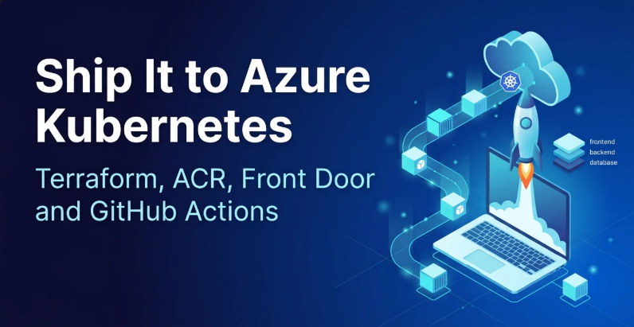
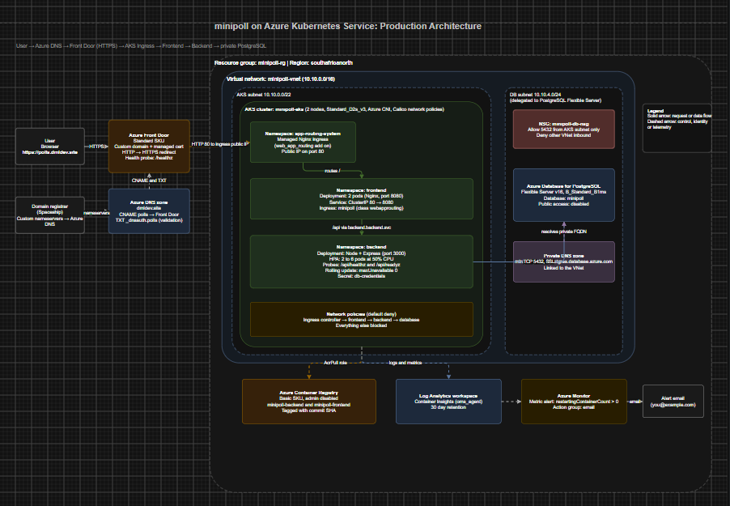
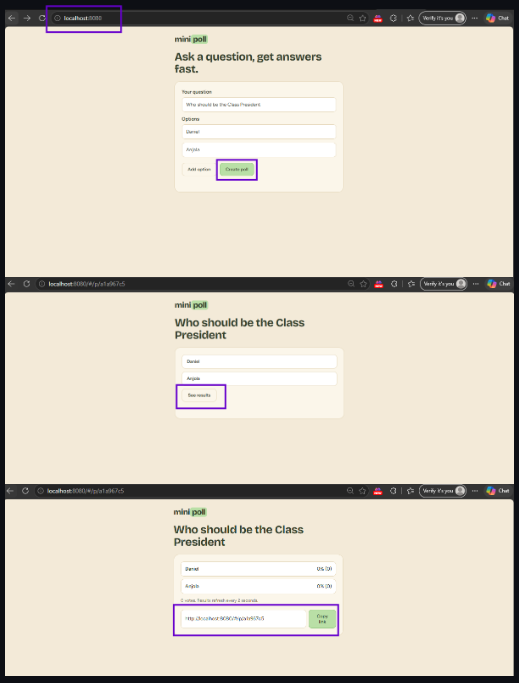
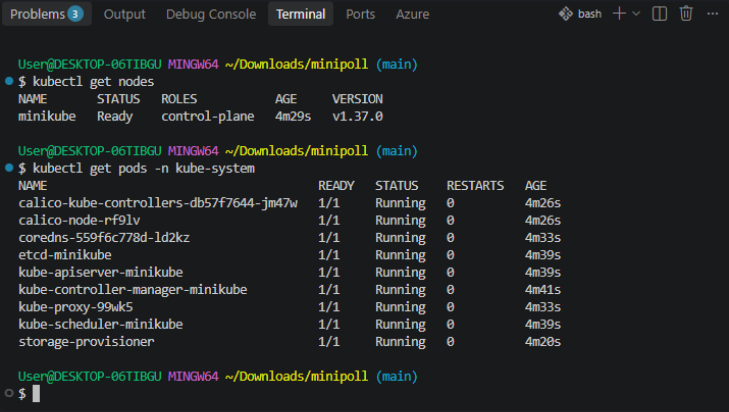
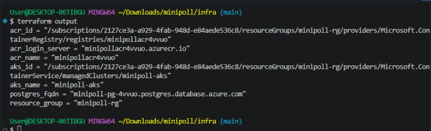
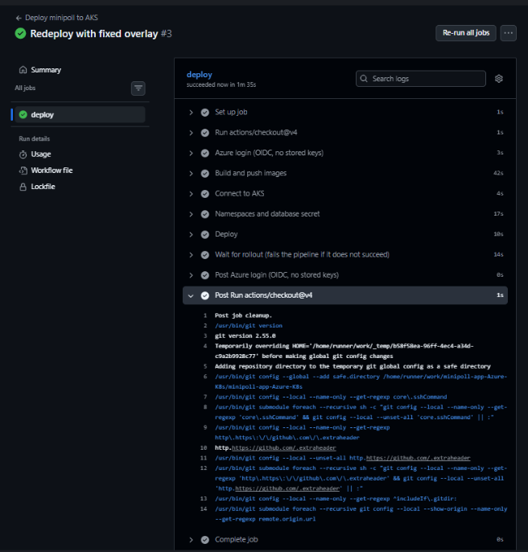
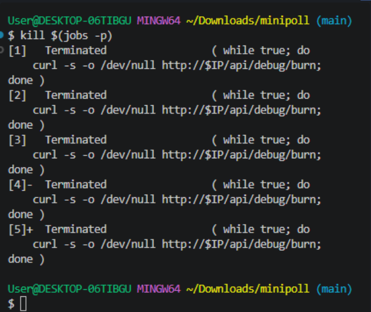
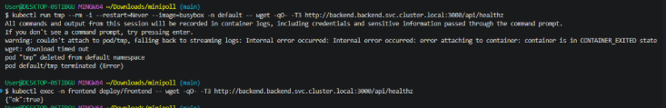

# minipoll on Azure Kubernetes Service

A small polling app, deployed the way a real project would be. Create a poll, share the link, collect votes, and watch it all run on Kubernetes with the infrastructure built by Terraform and deployed by GitHub Actions.

I built this to learn how containers, Kubernetes, cloud infrastructure and CI/CD fit together, and I wrote down everything I did, including the mistakes. If you want the full story behind this repo, the step by step walkthrough is on Hashnode:

[Deploying a Three Tier App on Azure Kubernetes Service with Terraform, ACR, Front Door and GitHub Actions](https://dmlops.hashnode.dev/deploying-a-three-tier-app-on-azure-kubernetes-service-with-terraform-acr-front-door-and-github-actions)



---

## Project Overview

minipoll is a three tier application:

**Frontend:** a static site served by Nginx
**Backend:** a Node and Express API
**Database:** PostgreSQL

The project follows the same path a real deployment would. First it runs on your laptop with Docker Compose. Then it moves to a local Kubernetes cluster with minikube, where you can safely test autoscaling, network policies and rolling updates. Finally, the same manifests are deployed to Azure Kubernetes Service (AKS), with everything in Azure created by Terraform.

Here is the traffic flow in production:

```
User → Azure Front Door (HTTPS) → AKS Ingress → Frontend (Nginx) → Backend (Node) → PostgreSQL
```

Locally, the database runs as a pod in minikube. On Azure, it is a private managed PostgreSQL Flexible Server, and the local database is never deployed to the cloud.

---

## Technologies Used

| Area | Tools |
|---|---|
| Application | Node.js, Express, Nginx, PostgreSQL |
| Containers | Docker, Docker Compose |
| Local Kubernetes | minikube, kubectl, Calico, Nginx Ingress |
| Config management | Kustomize (base and overlays) |
| Infrastructure as code | Terraform (azurerm and random providers) |
| Azure services | AKS, Azure Container Registry, Azure Database for PostgreSQL Flexible Server, Virtual Network, Azure DNS, Azure Front Door, Log Analytics, Azure Monitor |
| CI/CD | GitHub Actions with OIDC login to Azure |
| Command line | Azure CLI, Git Bash, PowerShell |

---

## Project Structure




## Main Features

**Runs anywhere you need it.** The same app works with Docker Compose, minikube and AKS, thanks to Kustomize overlays that change only what differs between environments.

**Self healing and zero downtime.** Liveness and readiness probes restart stuck containers, and rolling updates with `maxUnavailable: 0` mean a deployment never removes a pod before its replacement is ready.

**Autoscaling.** A Horizontal Pod Autoscaler grows the backend from 2 to 6 pods when CPU passes 50 percent of its request.

**Network isolation.** Network policies deny all traffic by default and allow only the chain you need: ingress controller to frontend, frontend to backend, backend to database.

**Private database on Azure.** PostgreSQL Flexible Server sits in a delegated subnet with public access turned off, and a network security group only lets the AKS subnet reach port 5432.

**Keyless deployments.** GitHub Actions logs in to Azure with OIDC, so there are no access keys or client secrets stored in GitHub. The only secret is the database password.

**Traceable releases.** Every image is tagged with the commit SHA, so any running container can be traced back to exact code.

**Custom domain with HTTPS.** Azure Front Door provides a managed certificate and redirects HTTP to HTTPS.

**Monitoring and alerts.** Container Insights is enabled on the cluster, and an alert emails you when a container restarts.



---

## Setup Instructions

### Prerequisites

Install or create the following first:

1. Docker Desktop (with at least 4 GB of memory allocated)
2. Git and VS Code
3. kubectl and minikube
4. Terraform
5. Azure CLI and an Azure account
6. A GitHub account
7. A domain name, if you want the custom domain and HTTPS part

Check Docker has enough memory:

```bash
docker info --format "{{.MemTotal}}"
```

### Step 1: Clone the repository

```bash
git clone https://github.com/dml-ops/minipoll-app-Azure-K8s.git
cd minipoll-app-Azure-K8s
```

### Step 2: Run it locally with Docker Compose

```bash
docker compose up -d --build
docker compose ps
curl http://localhost:8080/api/healthz
```

You should see `{"ok":true}`. Open `http://localhost:8080`, create a poll and vote. When you are done:

```bash
docker compose down
```

### Step 3: Run it on minikube

Start the cluster. Calico is needed so network policies are actually enforced.

```bash
minikube start --driver=docker --cni=calico --cpus=2 --memory=3072 --wait-timeout=15m
kubectl get nodes
kubectl get pods -n kube-system
```

Wait until the node is `Ready` and every pod in `kube-system`, including `calico-node`, is `Running`. Then enable the add ons:

```bash
minikube addons enable ingress
minikube addons enable metrics-server
```

Build the images and load them into minikube. Use the `:dev` tag, never `:latest`.

```bash
docker build -t minipoll-backend:dev ./backend
docker build -t minipoll-frontend:dev ./frontend
minikube image load minipoll-backend:dev
minikube image load minipoll-frontend:dev
```

Create the namespaces, the database and the secrets:

```bash
kubectl apply -f k8s/base/namespaces.yaml
kubectl apply -f k8s/local-db/postgres.yaml

kubectl create secret generic postgres-credentials -n database \
  --from-literal=POSTGRES_USER=minipoll \
  --from-literal=POSTGRES_PASSWORD=localpass \
  --from-literal=POSTGRES_DB=minipoll

kubectl create secret generic db-credentials -n backend \
  --from-literal=DB_USER=minipoll \
  --from-literal=DB_PASSWORD=localpass
```

Deploy the whole app with Kustomize:

```bash
kubectl apply -k k8s/overlays/local
kubectl get pods -A
```

On Windows with the Docker driver, open a second terminal and keep this running:

```bash
minikube tunnel
```

Then visit `http://127.0.0.1`.



### Step 4: Build the Azure infrastructure with Terraform

Log in and register the services Terraform needs:

```bash
az login
az account show --query id -o tsv

az provider register --namespace Microsoft.ContainerService
az provider register --namespace Microsoft.DBforPostgreSQL
az provider register --namespace Microsoft.Cdn
az provider register --namespace Microsoft.OperationalInsights
```

Create `infra/terraform.tfvars` with your own values. This file is ignored by Git, so keep it private.

```hcl
subscription_id = "your-subscription-id"
db_password     = "a brand new letters and numbers password"
alert_email     = "you@example.com"
```

Then run:

```bash
cd infra
terraform init
terraform fmt
terraform validate
terraform plan
terraform apply
```

The cluster takes around 5 to 10 minutes and the database a few more. Connect to the new cluster:

```bash
az aks get-credentials -g minipoll-rg -n minipoll-aks --overwrite-existing
kubectl get nodes
```

A quick note on cost: AKS and PostgreSQL bill by the hour, so run `terraform destroy` when you finish.



### Step 5: Fill in the Azure overlay

From the project root, replace the placeholders in `k8s/overlays/azure/kustomization.yaml` with real values:

```bash
cd ..
sed -i "s|ACR_LOGIN_SERVER|$(terraform -chdir=infra output -raw acr_login_server)|g" k8s/overlays/azure/kustomization.yaml
sed -i "s|POSTGRES_FQDN|$(terraform -chdir=infra output -raw postgres_fqdn)|g" k8s/overlays/azure/kustomization.yaml
```

Leave `IMAGE_TAG` alone. The pipeline fills it in with the commit SHA. Make sure there are no stray `**` characters in the file, since they cause an `InvalidImageName` error.

### Step 6: Connect GitHub Actions to Azure with OIDC

Create the identity and the trust rule. Replace the repo name if you forked it.

```bash
az ad app create --display-name minipoll-github
APP_ID=$(az ad app list --display-name minipoll-github --query "[0].appId" -o tsv)
az ad sp create --id $APP_ID

cat > credential.json << 'EOF'
{
  "name": "github-main",
  "issuer": "https://token.actions.githubusercontent.com",
  "subject": "repo:YOUR_USERNAME/minipoll-app-Azure-K8s:ref:refs/heads/main",
  "audiences": ["api://AzureADTokenExchange"]
}
EOF

az ad app federated-credential create --id $APP_ID --parameters credential.json
rm credential.json
```

Give it two permissions, to push images and to deploy:

```bash
export MSYS_NO_PATHCONV=1

az role assignment create --assignee $APP_ID --role AcrPush \
  --scope $(terraform -chdir=infra output -raw acr_id)

az role assignment create --assignee $APP_ID \
  --role "Azure Kubernetes Service Cluster Admin Role" \
  --scope $(terraform -chdir=infra output -raw aks_id)
```

In your GitHub repository, open Settings, then Secrets and variables, then Actions, and add these.

**Variables:**

| Name | Value |
|---|---|
| AZURE_CLIENT_ID | the APP_ID from above |
| AZURE_TENANT_ID | `az account show --query tenantId -o tsv` |
| AZURE_SUBSCRIPTION_ID | `az account show --query id -o tsv` |
| ACR_NAME | `terraform -chdir=infra output -raw acr_name` |
| AKS_NAME | minipoll-aks |
| RESOURCE_GROUP | minipoll-rg |

**Secret:**

| Name | Value |
|---|---|
| DB_PASSWORD | the database password from terraform.tfvars |

### Step 7: Add the domain, Front Door and HTTPS

Once the pipeline has deployed, find the public IP of the ingress:

```bash
kubectl get svc -n app-routing-system
```

Add it to `infra/terraform.tfvars`:

```hcl
ingress_ip = "the EXTERNAL-IP you just found"
```

Apply the edge resources, then print the nameservers:

```bash
cd infra
terraform apply
terraform output name_servers
```

At your domain registrar, switch to custom nameservers and enter the four Azure ones. DNS can take a few minutes to a few hours to propagate, after which Front Door validates the domain and issues the certificate by itself.

### Step 8: Turn on monitoring

`monitoring.tf` creates an action group and a restart alert. After `terraform apply`, check your inbox and click the confirmation link from Azure, otherwise alert emails will never arrive.

---

## Workflow Usage Guide

### Everyday deployments

Once everything is set up, deploying is just a push:

```bash
git add .
git commit -m "Describe your change"
git push origin main
```

The GitHub Actions workflow then:

1. Logs in to Azure with OIDC
2. Builds the backend and frontend images and tags them with the commit SHA
3. Pushes them to Azure Container Registry
4. Connects to AKS and applies the namespaces
5. Creates or updates the database secret from `DB_PASSWORD`
6. Applies the Azure overlay with Kustomize
7. Waits for both rollouts to finish, and fails the run if they do not

Watch the run in the Actions tab of your repository.



### Try the resilience demos on minikube

**Self healing.** Delete a backend pod and watch it come back:

```bash
kubectl get pods -n backend
kubectl delete pod YOUR_BACKEND_POD_NAME -n backend
```

**Autoscaling.** Watch the autoscaler in one tab, and create CPU load in another:

```bash
kubectl get hpa -n backend -w
```

```bash
IP=127.0.0.1
pids=()
for i in $(seq 1 5); do
  (while true; do curl -s -o /dev/null http://$IP/api/debug/burn; done) &
  pids+=($!)
done
```

Stop the load with `kill $(jobs -p)`.



**Zero downtime updates.** Send a steady stream of requests and restart the deployment at the same time. You should only see 200 responses.

```bash
while true; do curl -s -o /dev/null -w "%{http_code}\n" http://127.0.0.1/api/healthz; sleep 0.5; done
```

```bash
kubectl rollout restart deployment/backend -n backend
```

**Network policies.** This request from a random namespace should time out:

```bash
kubectl run tmp --rm -i --restart=Never --image=busybox -n default -- \
  wget -qO- -T3 http://backend.backend.svc.cluster.local:3000/api/healthz
```

This one, from inside a frontend pod, should return `{"ok":true}`:

```bash
kubectl exec -n frontend deploy/frontend -- \
  wget -qO- -T3 http://backend.backend.svc.cluster.local:3000/api/healthz
```



### Try the alert on Azure

The debug endpoints are off by default, which is how they should stay. For the demo only, temporarily set `ENABLE_DEBUG` to `"true"` with a patch in the Azure overlay, push, and wait for the pipeline to finish. Then:

```bash
curl https://your-domain/api/debug/crash
kubectl get pods -n backend
```

The RESTARTS column should go above 0, and an alert email arrives after a few minutes. Afterwards, set `ENABLE_DEBUG` back to `"false"` and push again.


### Switching between clusters

You will have two clusters in your kubeconfig. Always check where you are before you apply anything:

```bash
kubectl config current-context
kubectl config use-context minikube
kubectl config use-context minipoll-aks
```

---

## Troubleshooting Notes

A few things that tripped me up, in case they save you some time:

**Pods stuck in Init or ContainerCreating on minikube.** Calico was not ready yet. Wait until `calico-node` is Running before enabling add ons.

**Ingress webhook timed out on apply.** The controller was still settling after a restart. Check `kubectl get pods -n ingress-nginx` and apply the ingress again.

**ImagePullBackOff for the minipoll images.** The images were missing from minikube, usually after `minikube delete`. Rebuild and run `minikube image load` again.

**InvalidImageName on AKS.** Stray `**` characters in `k8s/overlays/azure/kustomization.yaml`. Remove them and deploy from a new commit, since re running an old workflow redeploys the old file.

**Terraform complaining about restartingContainerCount.** Add `skip_metric_validation = true` inside the `criteria` block in `monitoring.tf`.

**Push rejected by GitHub.** Run `git pull origin main --rebase` and push again.

The Hashnode post covers each of these in more detail, including how I diagnosed them.

---

## Cleaning Up

When you are finished, destroy the Azure resources so you stop paying for them:

```bash
cd infra
terraform destroy
cd ..
az ad app delete --id YOUR_APP_ID
minikube stop
```

Then check the portal for leftovers. AKS creates a second resource group beginning with `MC_` that disappears with the cluster.

---

## Feedback

I am still learning, so if you spot something that could be done better, please open an issue or reach out. And if this helped you, a star on the repo is always appreciated.

Written up in full on Hashnode: [dmlops.hashnode.dev](https://dmlops.hashnode.dev/deploying-a-three-tier-app-on-azure-kubernetes-service-with-terraform-acr-front-door-and-github-actions)